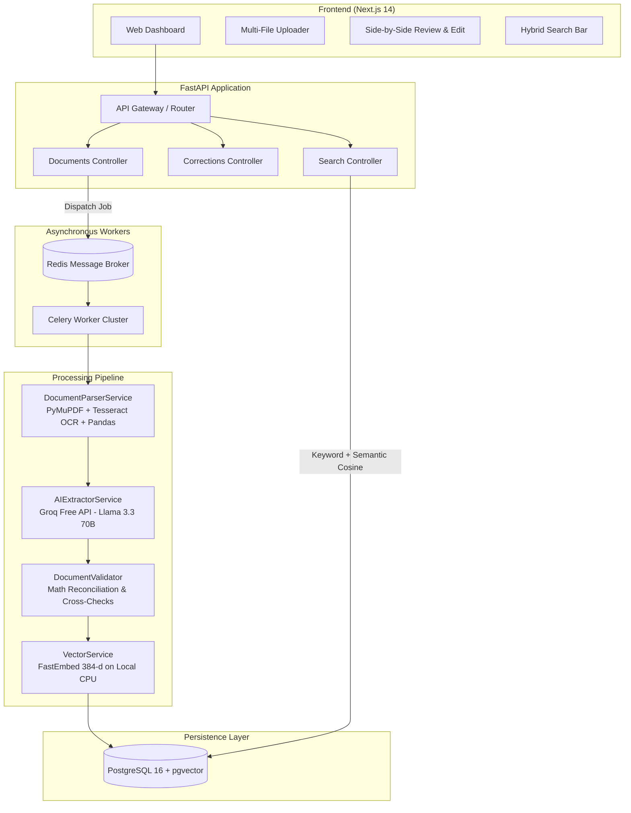

# AI-Powered Document Intelligence System

An enterprise-grade document intelligence system designed to ingest, extract, validate, and index financial documents (PDFs up to 1000 pages, scans, images, Excel spreadsheets, and CSVs) with zero hallucinations, deterministic mathematical validation, async Celery workers, and pgvector hybrid search.

---

## 1. System Architecture



---

## 2. Key Features

- **Multi-Format Streaming Ingestion:** Supports digital PDFs, scanned PDFs (fallback to OpenCV + Tesseract OCR), JPG, PNG, TIFF, and multi-sheet XLSX/CSV with memory-safe streaming for 1000+ page documents.
- **Zero-Hallucination AI Extraction:** Powered by Groq's free `llama-3.3-70b-versatile` with strict JSON Schema output. Any missing or ambiguous field is explicitly returned as `null`.
- **Deterministic Validation Engine:**
  - $\sum \text{Line Items} \approx \text{Subtotal}$ (tolerance: 0.05).
  - $\text{Subtotal} + \text{Tax} \approx \text{Total Amount}$.
  - Missing field warnings and duplicate invoice detection in PostgreSQL.
  - Cross-verification between PDF extracted values and Excel ledger records.
- **pgvector Hybrid Search:** Combines keyword full-text matching with dense semantic cosine vector search powered by local FastEmbed (`BAAI/bge-small-en-v1.5`, 384 dimensions) on CPU.
- **Human-in-the-Loop Review UI:** Side-by-side editing interface displaying highlighted validation errors with real-time recalculation and vector re-indexing upon save.

---

## 3. How to Run in GitHub Codespaces

### Step A: Configure Environment Variables
Copy `.env.example` to `.env` and insert your free Groq API key:
```bash
cp .env.example .env
```
*(Get a 100% free key from [console.groq.com/keys](https://console.groq.com/keys) and paste it into `GROQ_API_KEY`).*

### Step B: Start Backend Infrastructure (Docker)
In your terminal, start the PostgreSQL + pgvector, Redis, FastAPI, and Celery services:
```bash
docker compose up -d --build
```
Verify all 4 containers are healthy:
```bash
docker compose ps
```

### Step C: Run Automated Tests
```bash
docker compose exec backend pytest backend/tests/ -v
```

### Step D: Run Evaluation Benchmark
```bash
docker compose exec backend python evaluation/evaluate.py
```

### Step E: Start Frontend (Next.js)
Open a new terminal tab in Codespaces and run:
```bash
cd frontend
npm install
npm run dev
```
