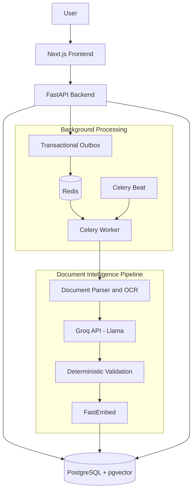
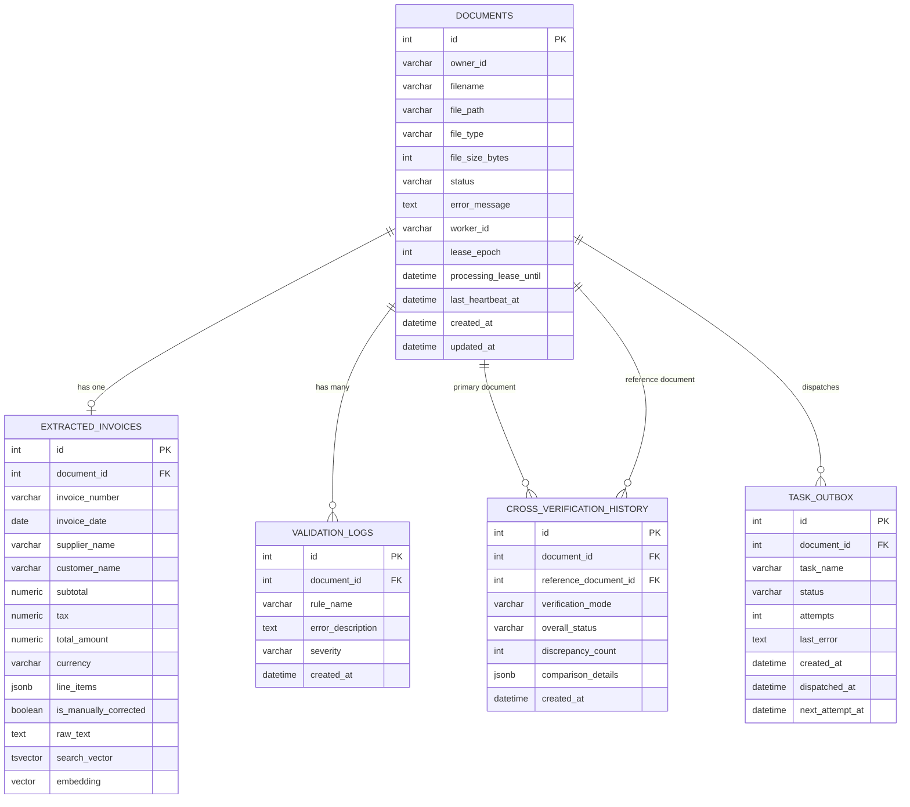

# AI-Powered Document Intelligence System

## Summary & Overview

The **AI-Powered Document Intelligence System** is an application that helps users extract, validate, review, compare, and search financial information from business documents such as invoices.

The system accepts multiple document formats, extracts text from digital and scanned files, and uses an AI model to convert the extracted content into structured invoice data. Deterministic validation rules then check required fields and financial consistency. Users can inspect the extracted information, correct inaccurate values, compare documents, and search processed records through the web interface.

The application is built around a FastAPI backend, PostgreSQL with pgvector, Celery and Redis for background processing, Groq-hosted Llama models for AI extraction, FastEmbed for embeddings, and a Next.js frontend.

**Manual testing note:** The developer has tested the application through the running frontend and reports that the tested application workflow worked as expected. A 100-page PDF was also successfully processed in this real-world test. This manual result is separate from the automated CI tests and the 1,000-page PDF page-iterator benchmark described in the project history.

Large and noisy files can take longer to process. Scanned pages require additional image preprocessing and OCR, while larger extracted text may require more AI processing. The project has been tested with a Groq free-tier API key, where applicable token and request limits can add waiting time or retries. A Groq plan or model configuration with higher applicable limits may improve throughput, but it does not guarantee a fixed processing time or a particular extraction result.

## Key Features

### Multi-format document upload
- Upload multiple documents in one request through the web application.
- Validate file extensions, file content signatures, file size, and file count.
- Store document metadata and queue processing jobs in the background.

### Document parsing and OCR
- Extract text from digital PDF files.
- Use Tesseract OCR for scanned PDFs and image-based documents.
- Apply OpenCV image preprocessing to help improve OCR input quality.
- Parse Excel workbooks, including multiple sheets, and CSV files.

### AI-powered invoice extraction
Extract structured invoice information using the configured Groq-hosted Llama model:
- Invoice number and invoice date
- Supplier and customer names
- Subtotal, tax, total amount, and currency
- Line items, including description, quantity, unit price, and line total

The extraction output is validated against a structured schema. Missing or unreadable information should remain unknown rather than being invented. AI output is treated as untrusted input and is checked by deterministic validation rules.

### Financial and data validation
- Detect missing required fields.
- Compare line-item totals with the invoice subtotal.
- Compare subtotal plus tax with the invoice total.
- Use decimal arithmetic for monetary calculations.
- Identify potential duplicate invoices.
- Store validation findings and their severity for review.

### Cross-document verification
- Compare one invoice with another PDF.
- Compare a PDF invoice against an Excel or CSV reference.
- Show discrepancies between extracted values and reference data.
- Keep a history of cross-verification results.

### Human review and correction
- Inspect extracted invoice fields and line items.
- Review validation errors and warnings.
- Correct inaccurate or incomplete extracted values.
- Save corrections and re-run validation.
- Reprocess eligible documents when needed.

### Search
- Keyword search using PostgreSQL full-text search and identifier matching.
- Semantic search using FastEmbed-generated vectors and pgvector.
- Hybrid search combining keyword and semantic rankings.

### Background processing
- Process documents asynchronously using Celery and Redis.
- Track processing status.
- Use a transactional outbox and periodic reconciliation for reliable task dispatch.
- Apply worker lease and fencing controls to reduce the risk of stale workers overwriting newer processing results.

## Supported File Formats

| Format | Supported input | Processing method |
|---|---|---|
| PDF | Digital and scanned PDFs | PyMuPDF text extraction with OCR fallback |
| JPG / JPEG | Scanned or photographed documents | Tesseract OCR with image preprocessing |
| PNG | Scanned or photographed documents | Tesseract OCR with image preprocessing |
| TIFF / TIF | Scanned image documents | Tesseract OCR with image preprocessing |
| XLSX | Excel workbooks | Pandas / OpenPyXL; workbook sheets are read |
| XLS | Legacy Excel workbooks | Pandas / xlrd |
| CSV | Tabular data | Pandas CSV parser |

Processing quality depends on document clarity, scan resolution, layout, language, and the consistency of the source data. Password-protected, malformed, or severely corrupted files may not be processable.

## Technology Stack

| Layer | Technology | Purpose |
|---|---|---|
| Frontend | Next.js, React, TypeScript | Web application and user interface |
| Styling | Tailwind CSS | Frontend styling |
| Backend | Python, FastAPI | REST API and application services |
| Validation / schemas | Pydantic | Request and structured extraction validation |
| ORM | SQLAlchemy | Database access |
| Migrations | Alembic | Version-controlled database schema |
| Database | PostgreSQL | Document metadata, invoice data, and history |
| Vector search | pgvector | Embedding storage and similarity search |
| Background processing | Celery | Asynchronous document processing |
| Message broker / result backend | Redis | Task queue and task results |
| PDF processing | PyMuPDF | PDF page and text extraction |
| OCR | Tesseract OCR | Text extraction from scanned pages and images |
| Image processing | OpenCV, Pillow | OCR image preprocessing |
| Spreadsheet processing | Pandas, OpenPyXL, xlrd | XLSX, XLS, and CSV parsing |
| AI extraction | Groq API, Llama model | Structured invoice information extraction |
| Embeddings | FastEmbed | Local text embedding generation |
| Automated tests | Pytest, HTTPX | Backend and API tests |
| Containerization | Docker Compose | Local service orchestration |

## System Architecture



### Component responsibilities

- **Next.js frontend:** Provides document upload, processing status, document inspection, manual correction, cross-verification, and search screens.
- **FastAPI backend:** Handles authentication, uploads, document access, corrections, reprocessing, verification, and search requests.
- **PostgreSQL:** Stores document metadata, extracted invoice data, validation findings, verification history, and task-outbox records.
- **pgvector:** Stores and searches dense embeddings for semantic search.
- **Redis:** Acts as the Celery message broker and result backend.
- **Celery worker:** Runs parsing, OCR, AI extraction, validation, persistence, and embedding tasks outside the API request lifecycle.
- **Celery Beat:** Schedules periodic reconciliation tasks.
- **Groq / Llama:** Extracts structured invoice data from parsed document text.
- **FastEmbed:** Generates embeddings locally for semantic and hybrid search.

## Database Design (ERD Design)

The application uses PostgreSQL with the pgvector extension. SQLAlchemy models define the entities, and Alembic manages database migrations.

### Main database entities

| Entity | Purpose |
|---|---|
| `documents` | Stores uploaded file metadata, owner, file location, processing status, and worker lease information. |
| `extracted_invoices` | Stores extracted invoice fields, line items, raw text, full-text search data, and vector embeddings. |
| `validation_logs` | Stores validation rule results, error descriptions, and severity levels. |
| `cross_verification_history` | Stores comparisons between a primary document and a reference document. |
| `task_outbox` | Stores durable background-task dispatch records for reliable processing and reconciliation. |

### Entity relationship diagram



### Search indexes

- A PostgreSQL GIN index supports full-text keyword search.
- A pgvector HNSW index supports cosine-distance semantic search.
- Additional indexes support document ownership, invoice identifiers, and background-task scheduling.

## Document Processing Workflow

1. **Upload:** The user selects one or more supported files in the frontend. The frontend sends them to the FastAPI upload endpoint.
2. **File validation:** The backend checks file count, size, extension, filename, and file content.
3. **Metadata persistence:** Document metadata and a task-outbox record are stored in PostgreSQL.
4. **Task dispatch:** The outbox service dispatches the processing task through Redis to Celery.
5. **Document parsing:** The worker extracts text from digital PDFs, invokes OCR for scanned pages or images, or parses spreadsheet data.
6. **AI extraction:** Parsed text is sent to the configured Groq Llama model to produce structured invoice data.
7. **Data validation:** The backend checks required fields, financial arithmetic, and duplicate conditions.
8. **Persistence and indexing:** Extracted data, raw text, validation findings, and embeddings are stored.
9. **Manual review:** The user can inspect the result, correct fields, and review validation findings.
10. **Search and verification:** The user can search processed documents or compare an invoice against another document.

### Main document statuses

- `queued` — accepted and waiting for background processing.
- `processing` — currently being processed by a worker.
- `validated` — processing and validation completed.
- `requires_manual_review` — the extracted result needs user inspection.
- `failed` — processing could not be completed.

## Project Structure

The following tree highlights the main application directories and files.

```text
ai-document-intelligence/
├── backend/
│   ├── api/
│   │   └── routes/              # Authentication, documents, corrections, search
│   ├── alembic/                 # Database migration environment and revisions
│   ├── core/                    # Configuration, database, security, Celery setup
│   ├── models/                  # SQLAlchemy models and Pydantic schemas
│   ├── services/                # Parser, OCR, AI, validation, search, outbox services
│   ├── tasks/                   # Celery processing and reconciliation tasks
│   ├── tests/                   # Backend and reliability tests
│   ├── Dockerfile
│   ├── MIGRATIONS.md
│   ├── SECURITY.md
│   └── requirements.txt
├── evaluation/
│   ├── benchmark_dataset/       # Synthetic documents and ground-truth manifest
│   ├── evaluate.py              # Extraction and validation evaluation
│   ├── generate_dataset.py      # Benchmark fixture generation
│   ├── benchmark_large_pdf.py   # PDF page-iterator benchmark
│   └── *_report.md              # Evaluation and benchmark reports
├── frontend/
│   ├── app/                     # Next.js application pages
│   ├── components/              # Upload, review, status, verification UI
│   ├── lib/                     # API client and frontend utilities
│   └── package.json
├── .github/workflows/           # GitHub Actions CI workflow
├── .env.example                 # Environment variable template
├── docker-compose.yml           # Development services
├── docker-compose.prod.yml      # Production Compose override
├── AI_PROMPTS_DISCLOSURE.md     # AI prompt and development disclosure
└── README.md
```

## Setup Manual

This section describes two ways to run and test the project:

1. **Real-World Testing:** Run the backend services and the Next.js frontend, then test the application through the browser.
2. **Backend-Only Testing:** Run the backend services and automated tests without starting the frontend.

### Prerequisites

Install the following:

- Git
- Docker Desktop with Docker Compose v2, or Docker Engine with the Compose plugin
- Node.js 22 and npm (only required for real-world frontend testing)
- A Groq API key for live AI extraction

### Clone the repository

```bash
git clone https://github.com/mdmazidulislam26/ai-document-intelligence.git
cd ai-document-intelligence
```

### Configure environment variables

Create the root environment file:

**Windows Command Prompt**
```cmd
copy .env.example .env
```

**PowerShell / macOS / Linux**
```bash
cp .env.example .env
```

Open `.env` and configure the Groq API key:

```env
GROQ_API_KEY=your_groq_api_key_here
```

The `.env.example` file contains the environment-variable template and local development defaults. Review it before running the application. Do not commit `.env` or share real API keys, database passwords, authentication secrets, or internal service tokens.

### A. Real-World Testing (Frontend + Backend)

Use this method to run the complete application and test the document workflow through the browser.

#### 1. Start backend services

From the repository root:

```bash
docker compose up -d --build
```

The development Compose setup starts the required backend services, including:

- PostgreSQL with pgvector
- Redis
- FastAPI backend
- Celery worker and scheduled reconciliation

Check the containers:

```bash
docker compose ps
```

Follow backend logs:

```bash
docker compose logs -f backend
```

Follow worker logs in another terminal:

```bash
docker compose logs -f celery_worker
```

#### 2. Start the frontend

Open a new terminal:

```bash
cd frontend
npm ci
```

Create `frontend/.env.local` if you need to specify the backend URL:

```env
NEXT_PUBLIC_API_URL=http://localhost:8000
```

Start the Next.js development server:

```bash
npm run dev
```

Open the application:

```text
http://localhost:3000
```

#### 3. Test the application

Use the frontend to test the following workflow:

1. Upload a supported document, such as a PDF, image, Excel workbook, or CSV file.
2. Confirm that the document appears in the document list.
3. Monitor its processing status.
4. Open the processed document and inspect the extracted invoice fields and line items.
5. Review validation results.
6. Edit incorrect or missing values and save the correction.
7. Upload a reference document and test cross-document verification.
8. Use keyword, semantic, or hybrid search to find processed documents.
9. Upload a multi-page PDF and observe the processing result and duration.

The developer has manually tested the running frontend and reports that the tested application workflow worked as expected, including successful processing of a 100-page PDF.

Large and noisy documents can take longer, especially when OCR is required and the configured Groq account is subject to free-tier token or request limits. A Groq plan or model configuration with higher applicable limits may reduce quota-related waiting and improve throughput. Actual processing time still depends on document complexity, OCR workload, model response time, network conditions, and provider limits.

#### 4. Stop the application

From the repository root:

```bash
docker compose down
```

To also remove the local Compose database volume (this permanently deletes the local database data), use:

```bash
docker compose down -v
```

Do not use `-v` if you need to keep uploaded-document metadata and database records.

### B. Backend-Only Testing

Use this method when you want to verify the backend, database migrations, and automated tests without running the Next.js frontend.

#### 1. Configure and start backend services

Complete the repository clone and `.env` setup described above. Then run:

```bash
docker compose up -d --build
```

Check service health and status:

```bash
docker compose ps
```

Check backend logs:

```bash
docker compose logs -f backend
```

#### 2. Verify the API

The backend API is available at:

```text
http://localhost:8000
```

Open the interactive API documentation:

```text
http://localhost:8000/docs
```

Alternative documentation:

```text
http://localhost:8000/redoc
```

The health endpoint is:

```text
http://localhost:8000/api/health
```

#### 3. Run automated backend tests

Run the backend test suite inside the backend container:

```bash
docker compose exec backend pytest tests/ -v
```

To run a particular test module:

```bash
docker compose exec backend pytest tests/test_concurrency_and_reliability.py -v
```

Use the test filenames present in the current repository if you want to run a different module.

#### 4. Verify database migrations

```bash
docker compose exec backend alembic current
```

To view migration history:

```bash
docker compose exec backend alembic history
```

#### 5. Run the evaluation script

The repository includes a synthetic evaluation dataset and an evaluation script. With the backend services running, execute:

```bash
docker compose exec backend python /app/evaluation/evaluate.py --delay 1.5
```

The script writes its report to the evaluation directory in the repository workspace.

To run the large-PDF page-iterator benchmark:

```bash
docker compose exec backend python /app/evaluation/benchmark_large_pdf.py
```

This benchmark measures the PDF page iterator only. It is not a measurement of the complete upload-to-extraction workflow.

#### 6. Stop backend services

```bash
docker compose down
```

### Useful service commands

| Task | Command |
|---|---|
| Start services | `docker compose up -d --build` |
| List service status | `docker compose ps` |
| View backend logs | `docker compose logs -f backend` |
| View worker logs | `docker compose logs -f celery_worker` |
| Run all backend tests | `docker compose exec backend pytest tests/ -v` |
| Check current migration | `docker compose exec backend alembic current` |
| Stop services | `docker compose down` |

## Authentication

The backend supports API-key authentication and short-lived bearer tokens.

### API key

Protected endpoints accept a configured API key through the `X-API-Key` request header.

```http
X-API-Key: YOUR_API_KEY
```

The development environment may provide a local development key through its example configuration. Use a new, private key for any non-development environment. Never publish a real API key.

### Bearer token

A valid API key can be exchanged for a short-lived HMAC-signed bearer token using:

```http
POST /api/auth/token
X-API-Key: YOUR_API_KEY
```

Example:

```bash
curl -X POST "http://localhost:8000/api/auth/token" \
  -H "X-API-Key: YOUR_API_KEY"
```

The response includes an access token, token type, expiry information, owner ID, and role.

Use the returned token on protected requests:

```http
Authorization: Bearer YOUR_ACCESS_TOKEN
```

Document access and related operations are scoped to the authenticated owner, with administrative access handled through the configured role and internal authorization rules.

## Security

The project includes several application-level security controls:

- API-key verification and signed bearer-token authentication.
- Owner-scoped authorization for document operations and search.
- Configurable CORS origins.
- File extension and content-signature validation.
- Filename sanitization and path-traversal checks.
- File-size and upload-count limits.
- Additional validation for spreadsheet archive content.
- Rate limiting for selected upload and write operations.
- Production checks for important secrets and configuration.
- Worker lease and fencing controls to reduce stale-worker updates.

### Security recommendations

Before exposing the application publicly or using it in a production environment:

- Replace all development credentials with strong, unique secrets.
- Keep `.env` and all API keys out of source control.
- Use HTTPS through a properly configured reverse proxy or load balancer.
- Use a managed secret store and establish a secret-rotation process.
- Consider database-backed user identity or an OIDC/OAuth2 provider for multi-user production deployments.
- Add malware scanning for uploaded files.
- Configure database backups, monitoring, logging, and alerting.

See [`backend/SECURITY.md`](backend/SECURITY.md) for additional security notes.

## Limitations

1. **Unclear or Poor-Quality Documents:** When a document is unclear, incomplete, or difficult to process, the system may take additional time, leave uncertain fields blank, or flag the document for manual review. This is an intentional safety measure to prevent incorrect or fabricated data from entering the system and to maintain data accuracy.

2. **Processing Time for Large Documents:** Large documents may take comparatively longer to process because the current implementation uses the Groq Free Tier API, which has limited usage quotas and rate limits. In a production environment, upgrading to a premium API plan with higher limits and throughput is expected to reduce API-related delays and improve processing speed. However, actual processing time may still depend on document complexity, OCR requirements, and network conditions.

## AI Usage Disclosure

This project uses AI in the document extraction stage.

- **AI provider:** Groq API.
- **Model family:** Llama model hosted through Groq; the exact model is configured through environment settings.
- **Purpose:** Convert parsed invoice text into structured invoice fields and line items.
- **Input:** Text extracted from uploaded documents through PDF parsing, OCR, or spreadsheet parsing.
- **Output:** Structured invoice data that is validated by the backend.
- **Embeddings:** FastEmbed is used locally to generate vectors for semantic search; it is separate from the Groq extraction call.

AI-generated values are not treated as automatically correct. The backend validates the response structure and applies deterministic checks for required fields, monetary arithmetic, and related consistency rules. Users can inspect and manually correct extracted information.

The AI model may still misread, omit, or incorrectly infer information. The system does not claim zero hallucinations or guaranteed extraction accuracy.

Development and evaluation prompts, together with the relevant AI-use notes, are documented in [`AI_PROMPTS_DISCLOSURE.md`](AI_PROMPTS_DISCLOSURE.md).

## Author

**Md Mazidul Islam**  
Software Engineer

- GitHub: [mdmazidulislam26](https://github.com/mdmazidulislam26)
- Repository: [AI-Powered Document Intelligence System](https://github.com/mdmazidulislam26/ai-document-intelligence)
